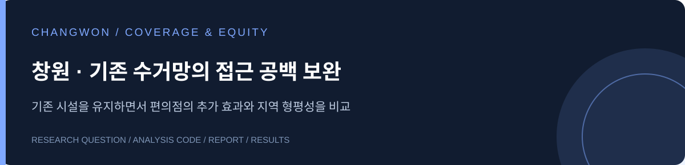

# 창원시 폐의약품 수거망 보완 입지 분석

기존 수거함이 있어도 가까이 이용할 수 없는 주민은 어디에 있을까? 기존 수거망을 유지하면서 편의점을 추가했을 때 늘어나는 접근 가능 인구와 구별 격차를 분석했습니다.

**[최종 보고서](reports/changwon_report.pdf) · [사용한 코드](code/) · [집계 결과](results/) · [데이터 준비](docs/DATA.md)**

## 주요 결과

100m 인구 격자의 중심점과 시설 간 **직선거리 350m**를 비교 기준으로 사용했습니다.

| 조건 | 전체 인구 커버율 | 최저 구 커버율 |
|---|---:|---:|
| 기존 수거망 | 69.15% | 64.04% |
| 편의점 60곳 추가: 효율안 | 87.40% | 82.32% |
| 편의점 60곳 추가: 형평안 | 86.24% | 85.87% |

효율안은 새롭게 커버하는 인구를 최대화하고, 형평안은 5개 구 중 가장 낮은 커버율을 먼저 높입니다. 설치 수, 단계별 추가, 일부 후보의 미참여, 거리 기준에 따른 결과도 비교했습니다.

## 분석 범위

- 기존 수거지 472개 등록 기록을 정리한 439개 좌표
- 검토 조건을 적용한 편의점 후보 802개 좌표
- 창원시 5개 구, 55개 읍면동
- SGIS 2024년 공개 인구와 2025년 공간 경계

커버율은 설정한 거리 안에 시설이 있는 **잠재 접근성**입니다. 실제 수거량이나 시민의 이용률과 구분합니다. 350m는 비교 조건이며 200~500m 민감도 분석을 함께 수행했습니다.

## 자료 찾기

`code/`에는 전처리, 최적화, 검증 및 시각화 스크립트를, `reports/`에는 제출 보고서를 모았습니다. `results/`에서 55개 읍면동 공백과 선정 후보를 확인할 수 있습니다. [코드 실행 순서](code/README.md)

팀: **SCOA**. 보고서에 기재된 공동 참여자와 출처를 유지했습니다.
